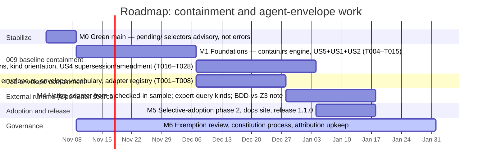

# Roadmap

Where this project is and where it is going. A layered timeline of the milestones follows the
milestone sections; dates are indicative, dependencies are the real content.

## Timeline (indicative)

Dependencies: M1 gates everything containment-related; M3 needs the M1 engine; M4 needs M3 and
its own input file (task T009); M5 ships after M2 (M4 may slip past the release); M6 runs
continuously. The shipped gates (features 001–008) are green; the
containment features (009 baseline containment, 010 envelope containment) are merged as staged
specifications with their conformance fixtures parked under `conformance/pending/`. Their origin
is an external source, cited for attribution in both specs' `research.md`:

- Alex Watson (OpenShell Team @ NVIDIA), "What we have learned applying formal methods to control
  AI agents," OpenShell Research Dev Notes, 2026-09-10.
  <https://nvidia.github.io/OpenShell-Research/dev-notes/posts/2026-09-10-learning-formal-methods-agent-policy-prover/>

That post proves, with an SMT solver, that a permission change proposed by an agent stays inside
the envelope the operator approved (`Allowed(candidate) ∖ Allowed(reference) = ∅`, witness on
`sat`, fail-closed on `unknown`). Features 009/010 implement the same containment query over
requirement models with binary decision diagrams — a deliberate divergence, recorded in
[decisions and their reasons](design/decisions.md#binary-decision-diagrams-rather-than-an-smt-solver)
— and extend it from agent runtime policy to specification revisions, project policy, supersession
unions, and amendments.

## Milestones

### M0 — Restore a green main ✅ (done 2026-11-02, feature `011-parked-selectors`)

Implemented as spec 011: missing selector files under configured `parked_selector_prefixes`
(default `conformance/pending/`; this repo also lists the four planned 009/010 implementation
files) are `TRACE_TEST_PARKED` advisories, not `TRACE_TEST_FILE` errors. Existing files, named-test
checks, and root/traversal checks are unchanged. `validate --phase final --all` is green with the
parked selectors named as advisories.

The 009/010 merge had left `validate --phase plan|tasks|final --all` red: their `traceability.toml`
files name selectors that do not exist yet (unwritten `conformance/pending/*/expected.json`,
`src/contain.rs`, `src/envelope.rs`, `src/adapters.rs`, `tests/determinism.rs`). The pending-corpus
README states unwritten cases are "reported as missing files," so by design an in-progress feature
holds the gate red — which conflicts with keeping `main` green for everyone else.

**Work:** teach the traceability gate that a selector under `conformance/pending/` is
declared-parked (advisory, never an error), so an in-progress feature never holds `main` red.
**Exit:** `validate --phase final --all` green with 009/010 selectors parked and named.

### M1 — 009 foundations, first usable slice ✅ (done 2026-11-02)

Shipped: `contain.rs` engine (manifest, per-effect shared BDD encodings with side-domain masks,
budget preflight, widening/narrowing witnesses verified by the independent enumerator, policy
conflict questions), `revision`/`policy` kinds, report `comparisons` records + summary counts,
human output, and 11 blessed conformance cases now in `conformance/cases/`. `supersession` and
`amendment` are accepted but reported `uncompared` until M2.

Tasks T004–T015 of `specs/009-baseline-containment/tasks.md`: the `contain.rs` engine — typed
comparison manifest with source provenance, one shared `bdd::Encoding` per effect question with
side-domain masks, state-budget preflight (refuse over-budget, never evaluate it), forward and
reverse differences with canonical witnesses, JSON and human reporting. Bless and move each
`contain-*` case from `conformance/pending/` into `conformance/cases/` as it goes green (T026).
**Exit:** US5+US1+US2 cases green in the live corpus; `final --all` green for the 009 scope.

### M2 — 009 completion ✅ (engine done 2026-11-02; Kiro-graph auto-resolution and Kiro amendment headings remain as follow-ups)

Shipped: derogations with validation/coverage/staleness, supersession as a masked union over
explicit candidate lists, Spec Kit amendment pairs, full kind orientation, shared-partition and
deprecated-term fixtures, determinism + differential witness tests; 20 `contain-*` cases live in
`conformance/cases/`.

Tasks T016–T028: derogations (deliberate widening, fully covered ⇒ advisory only), kind
orientation (`policy` is an upper bound, `amendment` is a refinement, `revision` asks no
conflict question), and US4 content checks over Kiro supersession and amendment links, building
on feature 008's active baseline. **Exit:** all 28 tasks done, full corpus green, docs updated.

### M3 — 010 envelope engine

Tasks T001–T008 of `specs/010-envelope-containment/tasks.md` (depends on M1): `envelope.rs` reads
versioned envelope definitions into phase/tool/transition effects with `PHASE-<name>`
identifiers, names every unmodelled construct, and discloses reachability as omitted; envelope
sources carry their own vocabulary (never `TERM_UNUSED`); `adapters.rs` is a fixed registry.
**Exit:** the `contain-envelope-*` cases moved into the corpus and green.

### M4 — Native adapter for a real agent guardrail runtime

This is the payoff of the external source: check in a real sample policy/workflow file from a
state-machine guardrail runtime (the OpenShell-style runtime the cited dev note describes) under
`conformance/pending/contain-envelope-native/`, write the mapping table and dropped-constructs
list in `contracts/envelope.md`, then implement the adapter (task T009 — blocked on that input,
by design: never write an adapter from documentation). Also port the dev note's four expert
queries (`l7_bypass_credentialed`, `credential_reach_expansion`, `capability_expansion`,
`link_local_reach`) as comparison kinds, and record the BDD-vs-Z3 divergence in
`docs/design/decisions.md` with the citation.

### M5 — Adoption and release

Turn on the second adoption phase of feature 007 per project, update these docs and the site, keep
`conformance/PARITY.md` current for a second implementation, and cut release 1.1.0 with
containment. CI stays split (Dagger for Linux, native runners for Windows and macOS) because
containment witnesses are exactly the cross-platform-sensitive output.

### M6 — Governance hygiene

Review the recorded separation exemptions periodically, amend the constitution only through its
documented process, and keep the OpenShell attribution current (add an arXiv/DOI reference if
NVIDIA formalizes the work).

## Rules that apply to every milestone

From the ratified constitution (`.specify/memory/constitution.md`): validation is read-only; the
resolved scope is printed on every run; a check that did not run is reported, never folded into a
pass; the behavioural contract is data; tests are written first and run red before implementation;
production code contains no requirement IDs and no copied EARS sentences.

## Main risks

- **State-budget blowup** on shared encodings — mitigated by preflight refusal (M1).
- **Witness stability** across runs and platforms — locked by `tests/determinism.rs` (T011).
- **Adapter drift** from the native runtime — mitigated by a versioned adapter plus a
  dropped-constructs honesty list (M4).
- **Pending-corpus hygiene** — never move an unimplemented case into `cases/` (T026/T010).
